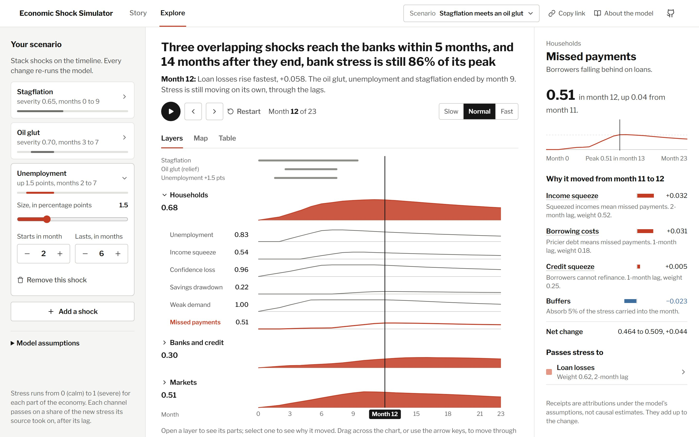

# Economic Shock Simulator

[](https://github.com/matthewbakerthompson/economicshocksimulator/actions/workflows/ci.yml)
[](https://github.com/matthewbakerthompson/economicshocksimulator/actions/workflows/pages.yml)
[](LICENSE)

An interactive, **explainable** simulator of how an economic shock spreads from households to banks to markets, with a receipt for every move.

This product models **directional stress propagation under stated assumptions** (it is not forecasting).

**[Live demo](https://matthewbakerthompson.github.io/economicshocksimulator/)**: runs entirely in the browser; the simulation runs in a Web Worker.

This is a public experiment. Questions, surprising results and ideas go in
[Discussions](https://github.com/matthewbakerthompson/economicshocksimulator/discussions);
what changed and why is in [CHANGELOG.md](CHANGELOG.md).


## Using it

The app opens on a **story**: the run's finding as a headline, a chart of stress on households, banks and markets over the months, and four or five chapters written from the run itself. *The shocks land*, then each layer's peak in the order it happens, then *the aftermath*. Press **Play the story**; each chapter plays its months and stops, and **Back**, **Next**, **Replay** and **Restart** do what they say. The headline and every number in the chapters come from the run, so a small shock honestly "barely reaches the banks".



**Explore** opens the whole model:

- **Your scenario (left):** stack shocks (unemployment, stagflation, an oil glut), each with a size and a window of months, or start from a scenario at the top. Lags, buffers and the horizon sit under *Model assumptions*. Every change re-runs the model at once.
- **Layers, Map and Table (centre):** *Layers* is the story's chart with each layer opening up into its parts; *Map* is the network of 14 parts and the channels between them; *Table* lists every part's stress, change and peak. Play, step, restart or drag across the chart to move through the months; the arrow keys work too.
- **Why it moved (right):** the selected part's stress over time, and the receipts for this month's move, each a channel or event written as a sentence, adding up to the change. Select a channel to follow the stress upstream, or a "passes stress to" row to follow it downstream.

Parts of the economy are named for the pressure they measure (*Confidence loss*, *Capital strain*, *Credit squeeze*), so a higher number always reads as worse. Color is one vermilion ink on a square-root scale, so the 0.02 to 0.1 a small shock leaves downstream still shows; relief is the only other hue.

**Share:** the URL always holds the view, scenario, month and selected part, and **Copy link** puts it on the clipboard. A story link with a month opens on that chapter. The hash reads like `#view=story&events=u1.5@2-7,s0.65@0-9&lags=medium&buffers=medium&horizon=24&month=16&node=consumers_delinquency`: each event is a type letter (u, s, o), its magnitude, and its first and last month. Anything missing or invalid falls back to the default.

## Quick start (Windows PowerShell)

```powershell
npm install
npm run dev
```

Open `http://localhost:5173/economicshocksimulator/` (the app is served under the same path as on GitHub Pages).

## Scripts

- **dev**: `npm run dev` (Vite dev server)
- **build**: `npm run build` (TypeScript + production build)
- **preview**: `npm run preview` (serve production build)
- **lint**: `npm run lint` (ESLint)
- **typecheck**: `npm run typecheck` (TypeScript, no emit)
- **test**: `npm test` (Vitest, once)
- **format**: `npm run format` (Prettier)

CI (`.github/workflows/ci.yml`) runs lint, type-check, tests and build on every pull request and push to `main`.
Each push to `main` also deploys the build to GitHub Pages (`.github/workflows/pages.yml`).

## Tests

`src/sim/*.test.ts` cover the simulation core and the story; `src/ui/ui.test.ts` and `src/state/*.test.ts` cover the helpers and state the interface relies on:

- the same scenario always produces the same result, and the scenario isn't mutated
- stress stays within `[0, 1]` however hard the scenario pushes, and stronger buffers never leave more stress
- a small shock rises and then fades back toward zero, and every feedback loop has a gain below 1
- each edge's weight is its pass-through: a node carries weight × its sources' lagged stress, with no compounding
- an injection reaches each node along each edge exactly that edge's lag later, and the short and long lag presets make every lag shorter or longer
- every change in a node's stress is accounted for by its receipts, including a clamp at 0 or 1
- event windows, unemployment scaling, stagflation's regime modifiers, and the oil glut relief being muted under stagflation
- the story's headline is the finding, its chapters run in time order with no gaps or rewinds, and it says so when a shock barely travels, when nothing happens, or when the shocks outlast the run
- each month's line names its biggest move and says which events are active, have ended or are still to come
- chapters play from their first month to their last and stop; jumping to a month pauses; playing at the end restarts
- the inspector's receipts sum to each move and use names, never ids; channels too small to print fold into one row
- every node and edge fits the network's layout, and the color scale is a square root, so small stress shows
- share links round-trip a scenario, recognise presets, and fall back to the defaults on bad input

## Project structure (high level)

- `src/components/`: the interface: the story (`StoryMode`), the explorer (`ExploreMode`), the stress-band chart (`LayerBands`), the map (`NetworkView`), the table, the scenario rail and the inspector
- `src/sim/`: simulation engine + worker + story generation
  - `engine.ts`: deterministic discrete-time propagation + receipts
  - `events.ts`: causal event stack + interaction rules
  - `presets.ts`: the named scenarios in the top bar
  - `narrative.ts`: the story: the finding, the framing line and the chapters, all computed from the run
  - `story.ts`: each month's line in the explorer
  - `*.test.ts`: Vitest tests for the engine, events, narrative and story
- `src/state/`: app state (Zustand), where every scenario edit re-runs the simulation, and the share-link format (`shareLink.ts`)
- `src/theme/`: theme tokens and global theme CSS
- `src/ui/`: the stress color scale, the network layout and edge geometry, and receipt formatting
- `src/hooks/`: playback, which advances by wall-clock time and stops at the end of a chapter
- `src/features/`: feature module entrypoints (barrel exports)
  - `src/features/simulator/index.ts`: stable import surface for simulator feature
- `src/shared/`: shared exports (theme/colors)
- `docs/`: the development plan (`devplan.md`), project plan (`projectplan.md`) and README images

## Core concepts

### Causal event stack (scenario composer)
Users can stack events (start/duration/magnitude). Example: **oil glut during stagflation**.

- The simulator applies **event injections** (positive or negative stress) to selected nodes
- Plus **regime modifiers** (e.g., stagflation increases persistence / transmission)
- Story output explicitly calls out interactions where defined

### Propagation model
Each node's stress (0 to 1) is a stock. Every month:
- active events add stress to the nodes they hit (or remove it, for relief)
- each edge passes on its weight × the new stress its source took on, `lag` months earlier
- buffers absorb a share of the stress each node carries: 3.5%, 5% or 7% a month for low, medium and high buffers
- if the result would leave `[0, 1]`, it is clamped

An edge passes on its source's new stress, not its source's whole level every month, so its weight is its pass-through. With nothing clamped, Income Stress is 0.55 × Unemployment two months earlier (the edge's one-month lag, plus the month the change takes to show). Every feedback loop has a gain below 1: the spectral radius of the weight matrix, with lags collapsed, is about 0.58, or 0.62 with stagflation's edge multiplier. So once the events end, stress fades back toward zero. A test fails if a graph change pushes that bound to 1.

The short and long lag presets scale every lag by 0.75 and 1.25 and round toward the preset, so one-month lags become zero or two months and two-month lags become one or three.

### Explainability
Every step produces receipts per node, and they sum to the node's change in stress:
- `shock`: direct event effects (and event interaction notes)
- `edge`: transmission along a channel (with lag + weight)
- `dampener`: buffers/decay (stability + realism guardrail)
- `clamp`: whatever the `[0, 1]` bounds cut off, when stacked shocks push a node past them

The inspector shows the receipts for the selected node's move into the current month, biggest drivers first, as bars that sum to the change.

## Adding a new event type (recommended workflow)

1. Add the event type to `src/sim/types.ts` (`EventType`)
2. Implement injections + interaction behavior in `src/sim/events.ts`
3. Give it a range and blurb in `src/components/ScenarioRail.tsx`, and a lane label in `src/components/LayerBands.tsx`
4. Add its name and phrasing in `src/sim/story.ts` (`eventName`, `eventPhrase`) and how the story describes it in `src/sim/narrative.ts`
5. Add its injections and interactions to `src/sim/events.test.ts`

## Non-goals (by design)
- Forecasting GDP/prices/returns
- Firm-level stress testing
- Real-time market feeds
- “Black box” outputs without receipts

## License

[MIT](LICENSE)
