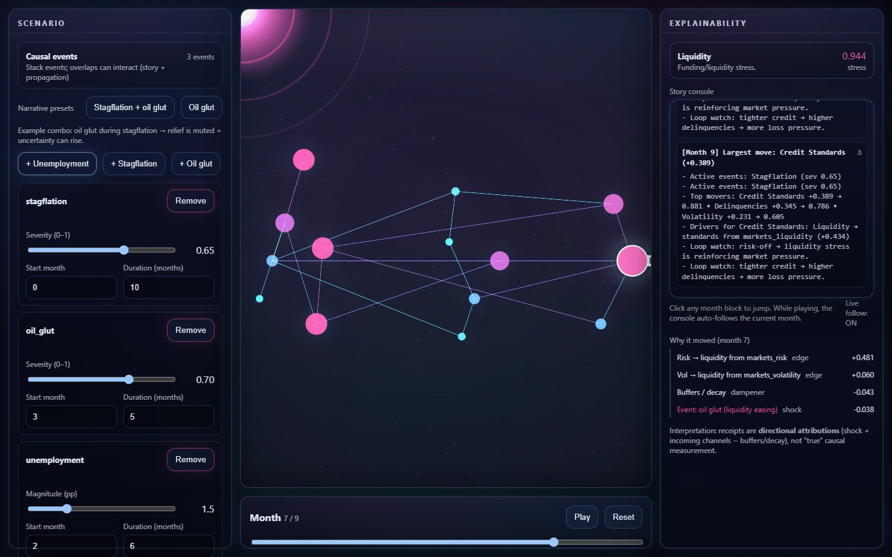

# Economic Shock Simulator

[](https://github.com/matthewbakerthompson/economicshocksimulator/actions/workflows/ci.yml)
[](https://github.com/matthewbakerthompson/economicshocksimulator/actions/workflows/pages.yml)

An interactive, **explainable** macro stress propagation simulator with a neon-cosmos aesthetic.

This product models **directional stress propagation under stated assumptions** (it is not forecasting).

**[Live demo](https://matthewbakerthompson.github.io/economicshocksimulator/)**: runs entirely in the browser; the simulation runs in a Web Worker.



## Quick start (Windows PowerShell)

```powershell
npm install
npm run dev
```

Open `http://localhost:5173/economicshocksimulator/` (the app is served under the same path as on GitHub Pages).

## Scripts

- **dev**: `npm run dev` (Vite dev server)
- **build**: `npm run build` (TypeScript + production build)
- **preview**: `npm run preview` (serve production build)
- **lint**: `npm run lint` (ESLint)
- **typecheck**: `npm run typecheck` (TypeScript, no emit)
- **test**: `npm test` (Vitest, once)
- **format**: `npm run format` (Prettier)

CI (`.github/workflows/ci.yml`) runs lint, type-check, tests and build on every pull request and push to `main`.
Each push to `main` also deploys the build to GitHub Pages (`.github/workflows/pages.yml`).

## Tests

`src/sim/engine.test.ts` and `src/sim/events.test.ts` cover the simulation core:

- the same scenario always produces the same result, and the scenario isn't mutated
- stress stays within `[0, 1 − buffer strength]` however hard the scenario pushes, and stronger buffers never leave more stress
- an injection reaches each node along each edge exactly that edge's lag later (and the long lag preset stretches two-month lags to three)
- every change in a node's stress is accounted for by its receipts
- event windows, unemployment scaling, stagflation's regime modifiers, and the oil glut relief being muted under stagflation

## Project structure (high level)

- `src/components/`: UI components (currently the main app panels/canvas)
- `src/sim/`: simulation engine + worker + story generation
  - `engine.ts`: deterministic discrete-time propagation + receipts
  - `events.ts`: causal event stack + interaction rules
  - `story.ts`: story beats derived from sim output (for the story console)
  - `*.test.ts`: Vitest tests for the engine and events
- `src/state/`: app state (Zustand)
- `src/theme/`: theme tokens and global theme CSS
- `src/ui/`: rendering helpers (color ramps, overlays, 2D math)
- `src/features/`: feature module entrypoints (barrel exports)
  - `src/features/simulator/index.ts`: stable import surface for simulator feature
- `src/shared/`: shared exports (theme/colors)
- `docs/`: the development plan (`devplan.md`), project plan (`projectplan.md`) and README images

## Core concepts

### Causal event stack (scenario composer)
Users can stack events (start/duration/magnitude). Example: **oil glut during stagflation**.

- The simulator applies **event injections** (positive or negative stress) to selected nodes
- Plus **regime modifiers** (e.g., stagflation increases persistence / transmission)
- Story output explicitly calls out interactions where defined

### Explainability
Every step produces receipts per node:
- `shock`: direct event effects (and event interaction notes)
- `edge`: transmission along a channel (with lag + weight)
- `dampener`: buffers/decay (stability + realism guardrail)

The UI renders this as a **story console** that scrolls as the sim plays and lets users click any month to jump back.

## Adding a new event type (recommended workflow)

1. Add the event type to `src/sim/types.ts` (`EventType`)
2. Implement injections + interaction behavior in `src/sim/events.ts`
3. Add a UI affordance in `src/components/ControlsPanel.tsx`
4. (Optional) Add story phrasing in `src/sim/story.ts`
5. Add its injections and interactions to `src/sim/events.test.ts`

## Non-goals (by design)
- Forecasting GDP/prices/returns
- Firm-level stress testing
- Real-time market feeds
- “Black box” outputs without receipts


